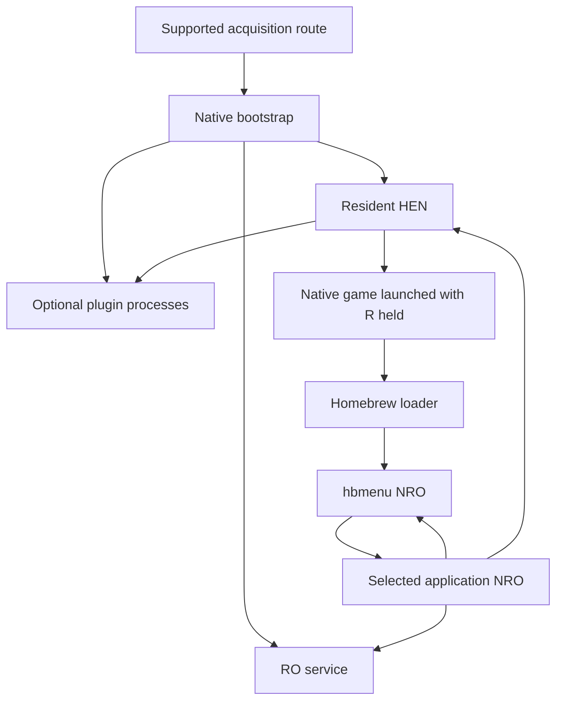

# kaiHEN Runtime Architecture and ABI

An application runs inside a loader-managed native game process, while HEN, RO and optional plugins have different lifetimes. Understanding that boundary explains why service ownership, thread shutdown and repeated launches matter as much as the first successful frame.

## Launch and execution topology

The diagram combines the component responsibilities documented by kaiHEN with the loader's application cycle. It is an architectural explanation, not an exploit sequence. [kaiHEN project overview](https://github.com/ouncebrew/kaihen/blob/e897f991524590833b82fbe8d63a3c6775fb8101/README.md) [Native NRO loader usage](https://github.com/ouncebrew/ounce-hbloader/blob/95f0e5dfbbcd28d678d30c99eeb5344feb0f6e71/README.md)

HEN starts first and hands plugins their own service sessions. In the inspected bootstrap, a plugin startup failure stops later plugins but does not undo an already-running HEN. Some comments in the plugin header describe older behavior; the bootstrap implementation and current plugin guide establish the sequence used here. [Bootstrap launch and plugin readiness](https://github.com/ouncebrew/kaihen/blob/e897f991524590833b82fbe8d63a3c6775fb8101/bootstrap/source/main.cpp) [Native plugin development guide](https://github.com/ouncebrew/kaihen/blob/e897f991524590833b82fbe8d63a3c6775fb8101/libkaihen/PLUGINS.md)

## Why the first R-held launch differs

HEN observes native game startup and can substitute the homebrew loader. On the first relevant launch it records the game's signed policy and permits the ordinary game to start; subsequent suitable launches can enter hbmenu. The policy cache affects whether a particular console sees one or two R-held launches during setup. [HEN runtime and launch policy](https://github.com/ouncebrew/kaihen/blob/e897f991524590833b82fbe8d63a3c6775fb8101/hen/README.md)

For testing, record the host title and whether its policy was already present. Do not classify a normal game launch as an application failure if the environment is still collecting policy. Conversely, the presence of hbmenu is the appropriate point to begin diagnosing an NRO.

## The application and process lifetimes

The loader starts `sdmc:/hbmenu.nro`, runs the selected program, and returns to the menu. The process can outlive many individual NROs. [Native NRO loader usage](https://github.com/ouncebrew/ounce-hbloader/blob/95f0e5dfbbcd28d678d30c99eeb5344feb0f6e71/README.md) Therefore a process-global resource that remains open at application return can affect a later program. This differs from the desktop assumption that process termination will close everything automatically.

The loader reserves a 64 MiB loader heap in its current implementation, then uses the remaining region for program staging and the heap override. The number is an implementation detail, not a universal application-memory guarantee. [NRO launch cycle and cleanup](https://github.com/ouncebrew/ounce-hbloader/blob/95f0e5dfbbcd28d678d30c99eeb5344feb0f6e71/switch2/clean_main.cpp)

Avoid a fixed “all RAM is available” assumption. The executable, assets, runtime, loader, renderer and operating-system resource limits all influence useful capacity. Test allocation failure paths rather than sizing an application from the console's advertised hardware memory.

## Service overrides and ownership

| Resource | Where it comes from | Ownership rule for an application |
| --- | --- | --- |
| `ldr:ro` session from `kaihenGetRoSession` | Loader service override | Borrowed; do not close the loader's handle |
| HEN session from `kaihenOpenHomebrewSession` | RO creates an independent session | Application closes its `Service` |
| FS or settings clone requested from HEN | HEN duplicates the relevant session | Close the returned owned handle |
| Process handle requested from HEN | Copy for the caller's process | Close the copy when finished |
| Plugin session from `henOpenPlugin` | Fresh session factory request | Application closes the session |

These distinctions are explicit in the client interface. A raw numeric handle does not itself encode ownership. [kaiHEN client API and handle ownership](https://github.com/ouncebrew/kaihen/blob/e897f991524590833b82fbe8d63a3c6775fb8101/libkaihen/include/kaihen.h)

The FS override is already initialized. libounce deliberately avoids sending `SetCurrentProcess` again because that would change the identity used by other holders of the shared root. [FS initialization and proxy identity](https://github.com/ouncebrew/libounce/blob/9382b1ec48ac5dabdaf52f1f99e0c0aacd02cd2f/nx/source/services/fs.c) Likewise, its SM initialization recognizes the loader's already-initialized override and avoids registering or closing that borrowed session. [Service overrides and borrowed SM session](https://github.com/ouncebrew/libounce/blob/9382b1ec48ac5dabdaf52f1f99e0c0aacd02cd2f/nx/source/services/sm.c)

For C++, wrap owned handles and services in noncopyable objects with explicit move behavior. Represent borrowed sessions separately. For C, keep ownership flags adjacent to the resource and use a single cleanup path that checks which acquisitions succeeded. Both approaches prevent accidental duplication of cleanup responsibility.

## The service-manager proxy

HEN gives clients independent SM proxy sessions rather than the shared underlying FS-identity session. A malformed or unsupported request can then terminate the offending client connection without taking the shared SM channel away from everyone. The proxy accepts client registration/detachment locally, forwards service lookup, and rejects registration and unregistration of services. [Per-client service-manager proxy](https://github.com/ouncebrew/kaihen/blob/e897f991524590833b82fbe8d63a3c6775fb8101/hen/source/sm_proxy.cpp)

This does not make every requested service available. A call may fail because of service existence, permissions, request format, firmware behavior, or resource pressure. Log the service name, operation and result before attempting a higher-level recovery.

## Protocol layout and negotiation

The inspected HEN protocol version is 6. `HenStatus` contains HEN's process ID, protocol version and initialization result. Homebrew command 0 queries status; commands 16–19 return core service or process resources; commands 20–22 enumerate and open published plugins. The protocol defines a 64-byte plugin-name record and a maximum of 16 published plugins. [HEN protocol constants and layouts](https://github.com/ouncebrew/kaihen/blob/e897f991524590833b82fbe8d63a3c6775fb8101/libkaihen/include/kaihen/protocol.h)

Treat protocol compatibility as feature negotiation. An application using only status should not assume that every future version requires rejection. A feature using commands 20–22 should require their documented availability. Record the protocol value in diagnostics, and distinguish a transport failure from a nonzero initialization result returned in an otherwise successful status reply.

## Runtime cleanup

libounce's exit path closes driver/window hooks, open service guards, the process-shared GSV sync state, and already-exited thread stacks. Its comments explain that those resources would otherwise survive into the next NRO. [Application initialization and exit hooks](https://github.com/ouncebrew/libounce/blob/9382b1ec48ac5dabdaf52f1f99e0c0aacd02cd2f/nx/source/runtime/init.c)

These mechanisms are recovery support. An application should still join its workers, stop audio and network activity, release renderer objects, close files and owned services, then return normally. A live worker executing code from an NRO being unloaded is a correctness failure even if the next menu appears.

## ABI design rules

Keep application-internal data structures separate from IPC payloads. Use fixed-width integer fields for wire formats, verify structure size and alignment, and avoid C++ object layouts or pointers in messages. The receiver's address space and lifetime differ from the sender's. In particular, an address returned for diagnostic purposes by RO is not automatically a usable application pointer.

Prefer library wrappers over direct HIPC construction until a specific missing command requires lower-level work. When direct IPC is necessary, preserve command numbers and payload layouts in a versioned header and validate them with host fixtures plus a minimal console probe.
