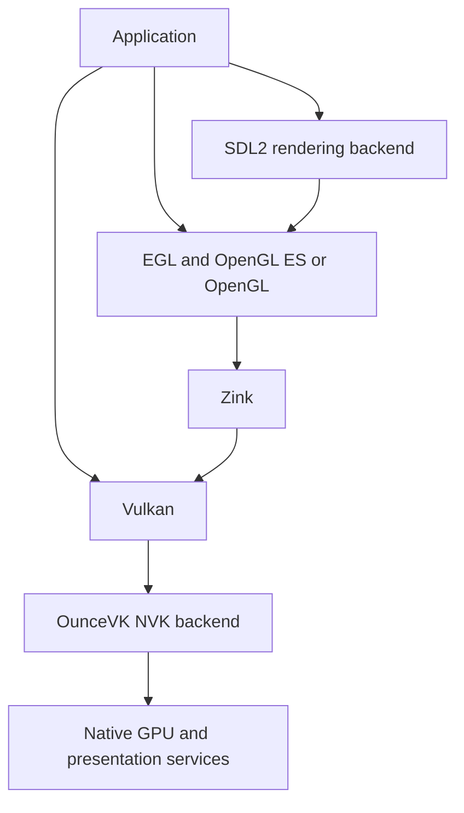

# kaiHEN Graphics and User Interfaces

OunceVK provides the practical native GPU route for this stack. Choose a rendering interface by the application's existing code and feature needs, then validate initialization, presentation and teardown separately.

## Rendering paths

The driver is derived from Mesa's NVK, with a Switch 2 backend. OpenGL runs through Zink over Vulkan; the driver is linked statically into each program. [OunceVK and Mesa overview](https://github.com/ouncebrew/ouncevk/blob/f5afcd27a98d47a35b7091b097ffd7f46b0be3e4/README.rst) The SDL2 branch describes the approach used by OunceShell, not a promise about every SDL backend. [OunceShell platform source and dependency build](https://github.com/kurumuz/ounceshell/blob/cb4c4ada491b4e0eb17f4d0419661095f96844e6/switch2/Makefile)

| Route | Suitable starting point | Main work to validate |
| --- | --- | --- |
| CPU console or framebuffer | Diagnostics and simple software rendering | Buffer conversion cost and presentation |
| SDL2 renderer | Existing 2D tools and games | Backend selection, textures, fonts, audio and input |
| EGL and GLES | Portable mobile-style renderers | Context, shader profile and feature queries |
| Direct Vulkan | Existing Vulkan engine or explicit GPU control | Surface, queues, synchronization and swapchain |
| Switch 1 low-level GPU code | Specialized existing renderer | Replace or redesign device-specific assumptions |

## Supported API claims

The Switch 2 driver guide advertises Vulkan 1.4, `VK_NN_vi_surface` on the default `NWindow`, and EGL-based OpenGL/ES with ES 3.1 stated at the time of writing. These are upstream project claims; this research does not establish Vulkan conformance certification or a tested matrix for every extension. [Native graphics interfaces and build guide](https://github.com/ouncebrew/ouncevk/blob/f5afcd27a98d47a35b7091b097ffd7f46b0be3e4/switch2/README.md)

Query the actual device properties, extensions, queue families, format capabilities and limits used by the application. For GLES, record `GL_VERSION`, `GL_RENDERER`, shader-language version and required extensions. A requested context version and a successfully created context are different observations.

Mesa's Zink documentation makes clear that exposed functionality depends on both Zink implementation and the underlying Vulkan driver's capabilities. Upstream desktop Zink support therefore does not independently prove an identical Switch 2 feature set. [Mesa Zink capabilities documentation](https://docs.mesa3d.org/drivers/zink.html)

## Linking correctly

The packaging script builds combined relocatable driver objects and provides `libvulkan.a` and `libEGL.a` linker scripts. It also supplies empty compatibility archives for some old Mesa library names to prevent accidental use of the Switch 1 versions. Internal Mesa symbols are localized to reduce application collisions. [Static graphics driver packaging](https://github.com/ouncebrew/ouncevk/blob/f5afcd27a98d47a35b7091b097ffd7f46b0be3e4/switch2/build/package-portlib.sh)

Inspect the final link map when porting an existing engine. Two libraries with the same filename can have different platform backends. In particular, a link that succeeds through old portlibs can still select an unsuitable graphics implementation.

Because the driver is static, changing the devkit does not update an already-built application. Preserve the driver's revision in application release metadata and rebuild when adopting a graphics fix. The `20261114` GPU-wait change is a concrete example. [ounce-devkit 20261114 release](https://github.com/ouncebrew/ounce-devkit/releases/tag/devkit-20261114)

## First Vulkan experiment

Use the devkit's `vulkan-clear` example as a reference for the surface and presentation path. It clears swapchain images without shaders, which reduces the number of failure sources in a first GPU experiment. It enables the VI surface platform, creates a surface from `nwindowGetDefault`, chooses a queue, acquires an image, submits work and presents it. [Vulkan clear reference application](https://github.com/ouncebrew/ounce-devkit/blob/f3478152dc553a104dd991efca4bde0c6e7cfe3e/examples/vulkan-clear/source/main.c)

For a production renderer, extend that baseline with explicit handling for resize or changed surface capabilities, out-of-date swapchains, allocation failures and optional formats. Keep a clear record of which frames are in flight and which synchronization object protects each resource. Do not reuse one acquired image or command buffer before its prior use is complete.

A useful debugging progression is: instance, physical device, logical device, surface, swapchain, one clear, repeated presents, one uploaded texture, shaders, then the real scene. Log the first failing call and its return value. Avoid a generalized “GPU failed” message that loses the stage boundary.

## First EGL and GLES experiment

The `gles-triangle` example creates an EGL display, chooses a GLES 3 configuration, makes a window surface from the default `NWindow`, creates a context and renders a rotating triangle. It logs the renderer and version strings. [GLES triangle reference application](https://github.com/ouncebrew/ounce-devkit/blob/f3478152dc553a104dd991efca4bde0c6e7cfe3e/examples/gles-triangle/source/main.c)

For an engine port, add shader compiler and linker logs before loading real content. Check render-target completeness and texture upload formats. A black screen can result from an incorrect viewport, missing vertex binding, invalid shader, wrong framebuffer or no presentation; it does not identify a driver defect by itself.

For GLES portability, keep shaders in a deliberate profile and build a small feature test for every nontrivial extension. Avoid silently compiling desktop GLSL through a GLES context.

## Resolution and presentation policy

libounce exposes per-mode dimensions and frame-rate policies on its native window API. [Window size and frame-rate policies](https://github.com/ouncebrew/libounce/blob/9382b1ec48ac5dabdaf52f1f99e0c0aacd02cd2f/nx/include/switch/display/native_window.h) VI2 exposes refresh and capability queries, plus requests for 120 Hz and VRR behavior. The API comments distinguish requests from guaranteed mode changes; system policy and display timings still affect the result. [VI2 presentation and display capabilities](https://github.com/ouncebrew/libounce/blob/9382b1ec48ac5dabdaf52f1f99e0c0aacd02cd2f/nx/include/switch2/services/vi2.h)

Treat render resolution, UI scale and output resolution as separate values. A tool can render its 3D scene below output resolution while keeping readable text at an appropriate scale. Recompute viewport and pointer transforms when the drawable extent changes. Record the actual selected extent and refresh rate in performance reports.

The hbmenu README describes native-resolution rendering up to 4K at 60 fps. That describes the menu project; it is not a general performance target for arbitrary homebrew. [Switch 2 menu usage and rendering](https://github.com/ouncebrew/ounce-hbmenu/blob/d7e10c028b53da17867615ee0a3c453b9cf9464a/switch2/README.md)

## UI architecture

For file managers and settings tools, use a UI state model independent of rendering. Define actions such as confirm, cancel, next item, pointer click and scroll, then bind controller, touch and pointer input to them. Keep text metrics and focus navigation deterministic.

Scale text and hit targets for handheld viewing as well as a television. Preserve focus when a directory refreshes, show progress for long operations, and keep an exit action reachable during recoverable failures. A low frame rate should not cause repeated destructive actions from a held button.

Fonts and image decoders can be larger porting dependencies than the initial renderer. OunceShell's build is a useful concrete reference for SDL2_ttf, HarfBuzz, FreeType, image formats and archive libraries. Reuse that dependency knowledge without assuming its entire package set is necessary for a smaller application. [OunceShell platform source and dependency build](https://github.com/kurumuz/ounceshell/blob/cb4c4ada491b4e0eb17f4d0419661095f96844e6/switch2/Makefile)

## Graphics diagnostics and shutdown

OunceVK sends Mesa diagnostics to `stderr`; logging options can be set before graphics initialization. Its guide recommends redirecting output to SD and describes a runtime exit hook that closes GPU state. [Native graphics interfaces and build guide](https://github.com/ouncebrew/ouncevk/blob/f5afcd27a98d47a35b7091b097ffd7f46b0be3e4/switch2/README.md)

An application should still wait for or cancel its own work, destroy resources in valid dependency order and release its surface/context. Test a second renderer application immediately after exit. That catches a class of leaked-process-state problems that a first frame cannot reveal.
