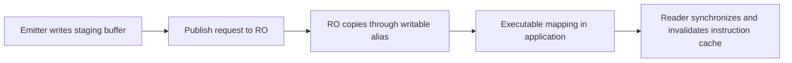

# kaiHEN JIT Emulation and Language Runtimes

kaiHEN exposes a JIT backend that lets applications retain the familiar libnx `Jit` interface while RO performs privileged mapping and publication work. This is useful for dynamic recompilers, but it introduces staging, synchronization and lifetime costs that must be designed into the runtime.

## Public interface and provider

Applications use `jitCreate`, `jitGetRwAddr`, `jitGetRxAddr`, transition calls and `jitClose`. Linking `-lkaihen` selects the provider object installed by the devkit. That object arrangement matters because the library hooks are weak references and can otherwise be omitted by ordinary archive extraction. [JIT backend development guide](https://github.com/ouncebrew/kaihen/blob/e897f991524590833b82fbe8d63a3c6775fb8101/libkaihen/JIT.md) [JIT provider and plugin library build](https://github.com/ouncebrew/kaihen/blob/e897f991524590833b82fbe8d63a3c6775fb8101/libkaihen/Makefile)

Test the final link, not just the presence of a header. Record an actual successful JIT creation in diagnostics, and retain an interpreter or non-JIT path when the application architecture permits it.

## Mapping and publication model



The RW address returned to the application is staging memory, not a directly coherent physical alias of executable memory. The RX address remains mapped across logical writable/executable transitions. Full publication copies staging contents through RO; sparse publication can send selected ranges. [JIT backend development guide](https://github.com/ouncebrew/kaihen/blob/e897f991524590833b82fbe8d63a3c6775fb8101/libkaihen/JIT.md)

This means a port that assumes “writing the RW alias immediately changes code visible at RX” needs modification. The writable-to-executable transition is a publication operation and can fail. Never call newly generated code after a failed publication simply because the pointer is non-null.

## Memory and mapping costs

libounce rounds a requested JIT allocation to pages, reserves executable address space and, for the alias backend, allocates a separate staging region in addition to backing memory. [JIT allocation and transition implementation](https://github.com/ouncebrew/libounce/blob/9382b1ec48ac5dabdaf52f1f99e0c0aacd02cd2f/nx/source/kernel/jit.c)

An approximate application budget is therefore:

```text
JIT memory ≈ executable backing + staging + metadata + fragmentation
```

That is a planning model, not a measured heap total. A 64 MiB code cache can require approximately another 64 MiB of staging before allocator overhead. Budget the emulator's RAM, textures, audio buffers and recompilation metadata separately.

RO's current helper has 512 JIT-record slots per initialized client session. This is a bookkeeping ceiling, not a guarantee that the kernel or available memory permits 512 live allocations of any size. [RO client and JIT bookkeeping limits](https://github.com/ouncebrew/kaihen/blob/e897f991524590833b82fbe8d63a3c6775fb8101/ro/source/session.h)

Prefer a measured number of larger arenas when the emitter can manage them safely. Thousands of tiny mappings may hit record limits long before raw memory is exhausted. Conversely, publishing an entire oversized arena for a tiny patch can waste IPC and copy bandwidth.

## Sparse publication

`kaihenJitPublishRanges` accepts byte ranges within staging. Its implementation validates ranges, combines eligible adjacent regions and packages publication data. [JIT provider and sparse publication](https://github.com/ouncebrew/kaihen/blob/e897f991524590833b82fbe8d63a3c6775fb8101/libkaihen/source/jit.c) The RO side validates the payload and writes through the retained mapping. [RO command validation and JIT publication](https://github.com/ouncebrew/kaihen/blob/e897f991524590833b82fbe8d63a3c6775fb8101/ro/source/session.cpp)

For a dynamic recompiler, collect dirty code intervals during one compilation batch, merge overlapping or adjacent intervals in a well-defined way, then publish once per safe batch. Measure copied bytes, request count and publish latency. Do not assume the helper's coalescing alone eliminates all emitter-side overhead.

## Multi-threaded execution

Publication invalidates the calling thread's instruction range. Other threads entering new code need their own synchronization and instruction-cache handling. Code must not be modified while another thread executes it, and readers must stop before a mapping is closed. [JIT backend development guide](https://github.com/ouncebrew/kaihen/blob/e897f991524590833b82fbe8d63a3c6775fb8101/libkaihen/JIT.md)

A straightforward design uses immutable code blocks: generate a new block, publish it, atomically make it reachable through a dispatch structure, then retire the old block only after all readers have left. This is an engineering pattern, not a facility automatically provided by kaiHEN.

For an initial port, keep emission and execution on one thread until the basic correctness path works. Add concurrent compilation only after defining publication barriers, entry-point visibility and reclamation.

## Cleanup and failed unmapping

The RO implementation tracks mapping ownership and retains records when cleanup cannot complete. [RO mapping and cleanup implementation](https://github.com/ouncebrew/kaihen/blob/e897f991524590833b82fbe8d63a3c6775fb8101/ro/source/mapping.cpp) The loader sends the release-all-JIT command when an NRO returns before reusing program memory. [NRO launch cycle and cleanup](https://github.com/ouncebrew/ounce-hbloader/blob/95f0e5dfbbcd28d678d30c99eeb5344feb0f6e71/switch2/clean_main.cpp)

An emulator should still close its own JIT objects and report cleanup failures. Reusing code-cache memory after a failed unmap can invalidate the ownership assumptions that made earlier mappings safe. A teardown failure should stop the normal restart path until the environment has been reconciled.

## Emulator porting sequence

1. Build the portable core in interpreter mode and validate input/output on the host.
2. Run a small native frontend with file loading and a known legal test program.
3. Verify graphics and audio independently.
4. Add one JIT arena and a minimal generated function.
5. Compare interpreter and recompiler outputs on deterministic fixtures.
6. Add invalidation and self-modifying-code cases relevant to the emulated system.
7. Test repeated startup, cache reset and exit.
8. Optimize only after recording publication and execution costs.

The exact tests depend on the guest system. A screenshot or a speed increase is not enough to establish instruction correctness, exception behavior or memory-ordering correctness.

## Language choices

C and C++ are the most directly demonstrated application languages in the devkit examples. Rust is present in OunceVK's build, including a custom target and standard-library build machinery, but that does not by itself establish a polished general Rust application SDK for kaiHEN. [Driver Rust target definition](https://github.com/ouncebrew/ouncevk/blob/f5afcd27a98d47a35b7091b097ffd7f46b0be3e4/switch2/toolchain/rust/aarch64-switch-horizon.json)

For Rust, begin with a small C ABI bridge to a validated libounce application and prove allocation, panic behavior, threads and NRO startup before importing a large framework. Pin target and linker choices. Existing Switch 1 Rust guides need a separate review for platform-specific service and graphics assumptions.

Lua or another interpreter can be embedded as portable C code, subject to build and runtime validation. Do not assume a language's upstream JIT supports this environment simply because it emits AArch64. It may depend on `mmap`, protection changes, signal handling or instruction-cache behavior that need an explicit adaptation.

For a large engine, expose a narrow native host API to scripts: input actions, assets, timing, rendering commands and application state. This keeps script portability separate from system-service access and makes deterministic host tests possible.
